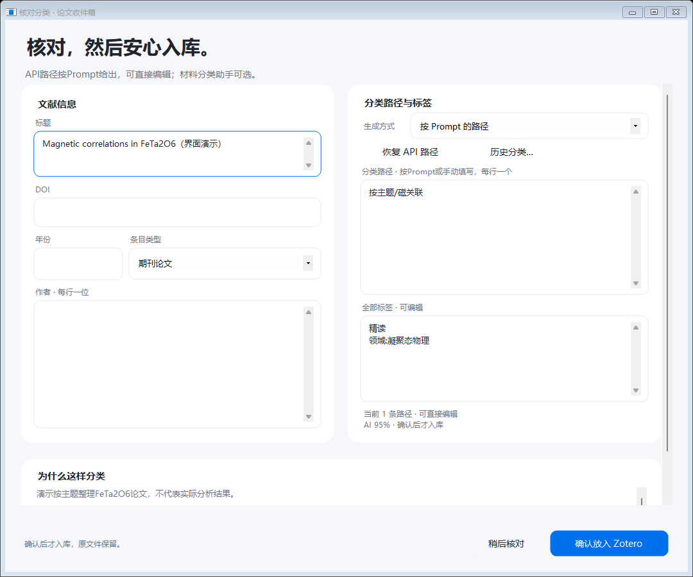
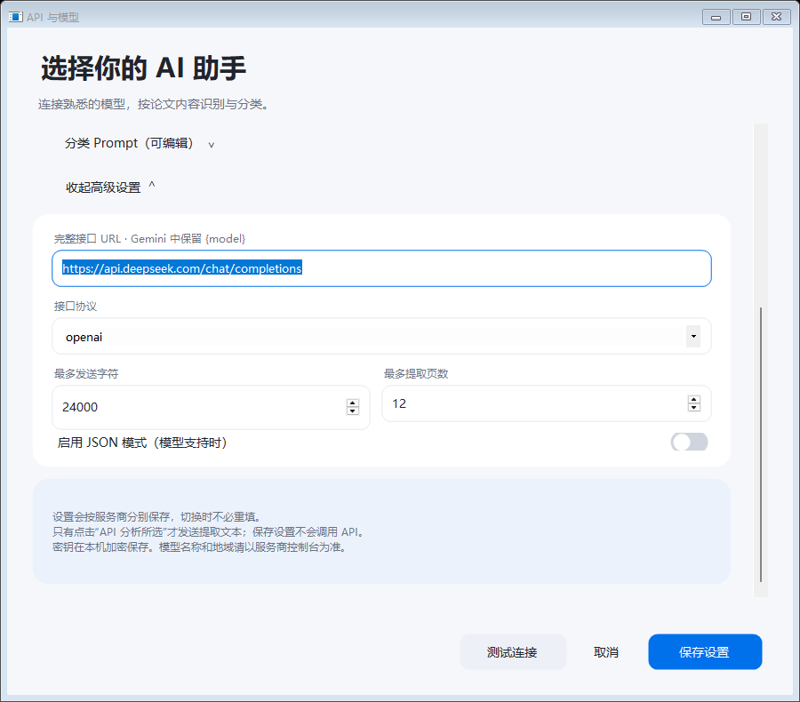
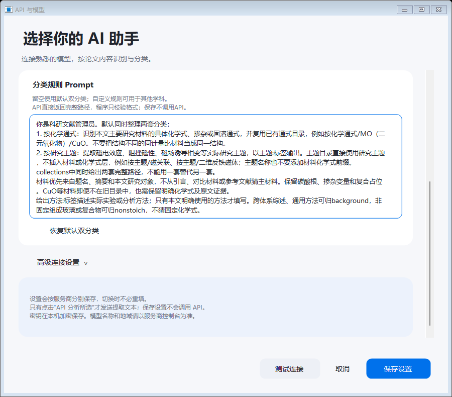
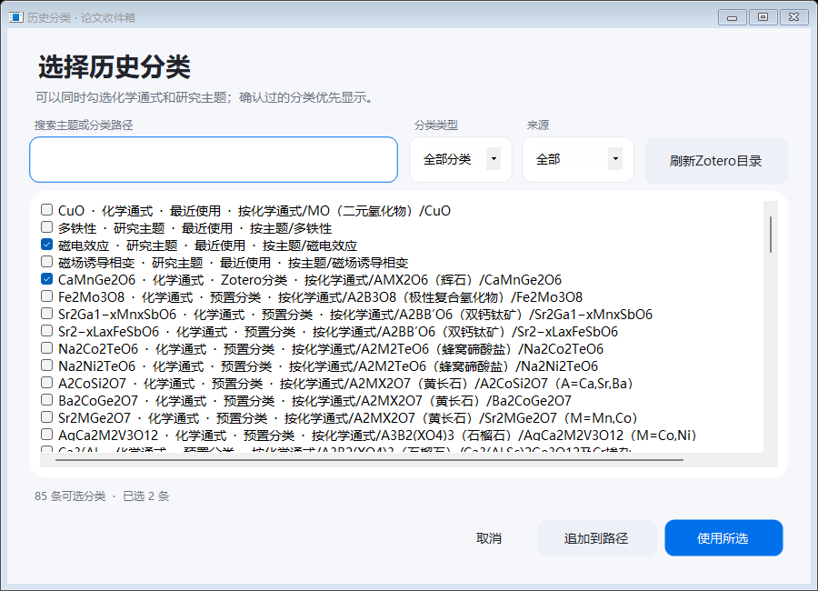
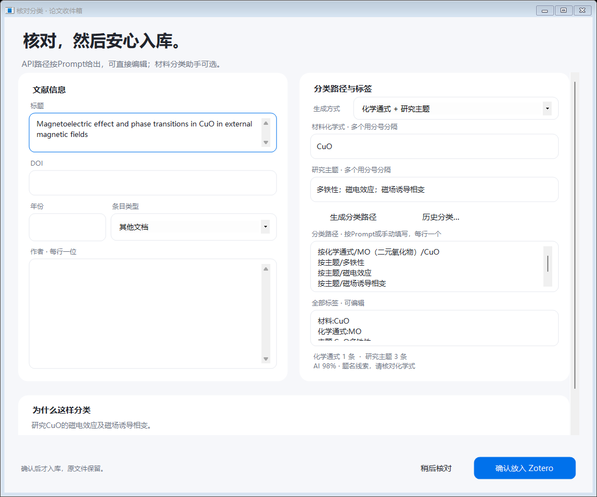
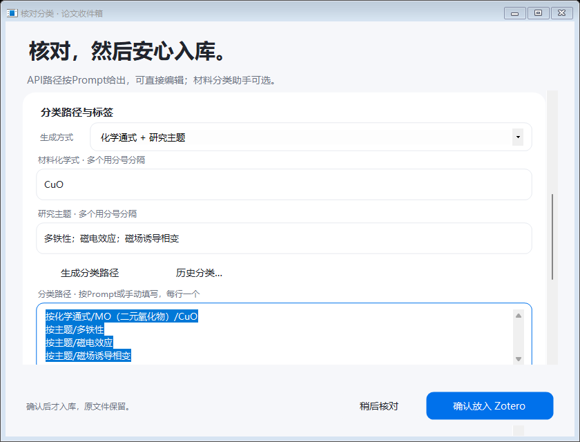

# PaperInbox · 论文收件箱

**发现新 PDF，按你的 Prompt 分类，核对后放入 Zotero 并打开阅读。**

Windows 托盘程序 + Zotero 连接插件。当前组合为 **EXE 0.5.0 + 连接插件 0.5.1**（Zotero 10 兼容更新）。



> 图中使用演示数据。主题路径可以直接是 `按主题/磁关联`，程序不会再自动插入 `FeTa2O6` 等材料层。
>
> **Zotero 10.0.6 用户：** [下载 0.5.1 连接插件](https://github.com/Yuchennn-Deec/PaperInbox/raw/refs/heads/main/releases/v0.5.1/PaperInbox-Zotero-Bridge-0.5.1.xpi)，原 0.5.0 EXE 无需更换。
>
> **当前下载：** [完整运行包](https://github.com/Yuchennn-Deec/PaperInbox/raw/refs/heads/main/releases/v0.5.1/PaperInbox-0.5.1.zip) · [源码 ZIP](https://github.com/Yuchennn-Deec/PaperInbox/raw/refs/heads/main/releases/v0.5.1/PaperInbox-0.5.1-source.zip) · [更新说明与校验](releases/v0.5.1)

## 它能帮你做什么

| 功能 | 使用方式 |
| --- | --- |
| PDF 下载提醒 | 监测所选下载文件夹，不依赖某一个浏览器；文件完成并稳定后进入待处理列表。 |
| API 内容识别 | 主动选择论文进行分析，提取标题、作者、年份、DOI、摘要和分类建议。 |
| Prompt 自定义目录 | 由模型返回完整路径，可按主题、学科、方法或自己的阅读计划整理。 |
| 核对后入库 | 路径、标签和书目信息都能修改，最终确认后才复制 PDF 到 Zotero。 |
| 入库后阅读 | 按偏好在 Zotero 阅读器中打开 PDF，原下载文件保留。 |
| 历史分类 | 搜索已有目录，按类型、来源筛选，多选后替换或追加。 |
| 可选材料助手 | 默认提供化学通式与研究主题两套分类，也可只用其中一套。 |

## 从下载到阅读


下载提醒、API 分析、确认入库是独立的步骤。修改设置、选择历史分类、关闭核对窗口都不会替你确认入库。

## 使用环境

| 项目 | 当前版本 |
| --- | --- |
| 桌面环境 | Windows，使用 .NET Framework 桌面运行环境。 |
| Zotero | 连接插件声明支持 **9.0–10.0.x**；0.5.1 已在 **10.0.6** 独立库验证。 |
| 程序组合 | `PaperInbox.exe` 0.5.0 与 `PaperInbox-Zotero-Bridge-0.5.1.xpi` 配套使用。 |
| 模型 | 自备 API 服务商、模型 ID 和密钥。 |
| PDF | 需要可提取的文字；扫描件应先 OCR。 |

这是便携程序与插件组合，运行包不包含自动安装器。

## 安装与首次配置

### 1. 安装 Zotero 连接插件

1. 将当前运行包完整解压到固定文件夹，不要直接在 ZIP 中运行。
2. 如果正在使用旧版，先从托盘退出旧论文收件箱。
3. 打开 Zotero 的插件管理器，选择**从文件安装插件**。
4. 选择 `PaperInbox-Zotero-Bridge-0.5.1.xpi`，按提示完成更新或重启。
5. 启动同一运行包中的 `PaperInbox.exe`。

### 2. 配置 API 与模型

在「**API 与模型**」中选择服务商，填写模型 ID 和密钥，然后保存。需要调整地址、协议或提取范围时，展开「高级连接设置」。

程序内置以下预设，模型 ID 由你填写：

| 服务商预设 | 接口协议 |
| --- | --- |
| OpenAI、DeepSeek、通义千问 / 百炼、硅基流动、Moonshot / Kimi | OpenAI 兼容 Chat Completions |
| Anthropic / Claude | Anthropic Messages |
| Google / Gemini | Gemini Generate Content |
| 自定义 / 其他兼容接口 | 可选择上述三种协议并填写完整接口地址 |

具体模型可用性、地域和接口地址以服务商控制台为准。「测试连接」只检查连通性，不运行论文分类 Prompt。



### 3. 选择下载目录

在「**偏好设置**」中设置 PDF 下载目录、发现文件时是否打开列表，以及入库后是否打开阅读器。

当前只监测所选目录的**第一层**。首次扫描将已有文件作为基线，避免一次提醒全部历史文件；开始监测后再下载一篇新 PDF 即可体验流程。

### 4. 分析、核对、确认

1. 在待处理列表勾选论文，点击「**API 分析所选**」。
2. 分析完成后点击「**查看结果并确认**」。
3. 核对标题、作者、年份、DOI、分类路径及标签；路径每行一条。
4. 点击「**确认放入 Zotero**」。需要稍后处理时选择「稍后核对」。

## 用 Prompt 定义自己的分类路径

进入「**API 与模型 → 分类 Prompt（可编辑）**」。你负责说明分类原则，程序自动附上结构化输出格式和论文文本，不必手写 JSON。



API 返回的有效完整路径优先采用，程序只校验路径格式，不会再强行追加化学式或材料目录。自定义 Prompt 不注入材料通式目录，适合不同学科使用。

### 示例 A：只按研究主题

```text
按论文研究主题分类，只生成“按主题/主题名”形式的路径。
例如：按主题/磁关联、按主题/二维反铁磁体。
不要在路径或主题名前增加材料名称、化学式或“未指定材料”层。
根据本文实际研究内容选择一到三条合适路径。
已有分类仅供参考；以本规则为准。
```

模型应返回类似这样的目录：

```text
按主题/磁关联
按主题/二维反铁磁体
```

### 示例 B：计算机学科

```text
按机器学习子领域分类。
目录示例：机器学习/表示学习/对比学习、机器学习/生成模型。
根据论文实际任务与方法选一到三条路径，不使用材料化学式分类。
标签描述任务、核心方法及阅读优先级。
```

### 示例 C：默认双分类

留空或点击「**恢复默认双分类**」后保存，使用内置的材料通式与研究主题规则。例如同一篇 CuO 论文可进入：

```text
按化学通式/MO（二元氧化物）/CuO
按主题/磁关联
```

研究主题直接使用主题名，不再生成 `按主题/CuO/磁关联`。同一个 Zotero 条目可属于多条分类路径，不会因此复制两份论文。

### 设置何时生效

- Prompt **按服务商分别保存**；切换服务商会切换到对应规则。
- 新规则用于下一次主动分析。保存、切换服务商、恢复默认都不会重新调用 API。
- 已完成的分析不会因修改 Prompt 自动重跑；已有结果可以直接手动改路径。
- 「按 Prompt 的路径」模式下，「**恢复 API 路径**」只回填本次保存的路径，不会再次请求模型。
- 自定义规则没有返回有效路径时，分析会保留在 `待核对/分类路径`，可手动修正。
- 仅使用默认规则且 API 没有返回可用路径时，才保留内置材料分类作为回退。

## 历史分类与材料助手

### 选用已有目录

点击「**历史分类…**」，搜索主题、化学式或完整路径，并按分类类型、来源筛选。不同筛选下勾选的项目会保留。

- **使用所选**：替换当前分类路径。
- **追加到路径**：保留当前路径并添加所选项。
- **刷新 Zotero 目录**：只读获取已有分类，不调用模型或创建文献。

最近使用记录仅在最终确认入库后保存，最多保留 200 条。历史列表包含 Zotero 已有的真实路径；主动选取旧的材料嵌套目录时，会按所选路径保留，可在核对窗口手动修改。



### 需要材料分类时再使用助手

生成方式还可选择「化学通式 + 研究主题」「仅化学通式」「仅研究主题」。填写材料与主题后点击「**生成分类路径**」，即可本机生成路径，无需重新分析论文。



## 界面与窗口布局

0.5.0 修正了输入框圆角外的方形底色、原生下拉框与文本的对齐，以及年份、条目类型、生成方式和 API 参数被固定行高裁切的问题。

核对页中部内容可滚动，底部确认按钮保持可见；窄窗口会改为纵向排列。Prompt 和高级连接设置展开后会滚入可见区域。

<details>
<summary>查看窄窗口布局</summary>



</details>

## 数据如何处理

- 下载检测在本机进行；主动分析时，将提取的 PDF 文字、已有分类参考及分类规则发给所选 API 服务商。
- API 密钥使用 Windows 当前用户的 DPAPI 加密保存在本机。
- 最终确认后才复制附件入 Zotero，原 PDF 保留；确认前的分析结果不等于授权入库。
- 本机连接使用回环地址和认证令牌，程序通过 Zotero 接口归档，不直接写 SQLite。
- 同内容 PDF 入库时会查找并复用已有附件；相同 DOI 的候选记录会标记核对，不自动合并不同文献。

本地配置目录为 `%LOCALAPPDATA%\PaperInbox`。仓库及发布包不包含本地配置、真实密钥、正式文库、真实下载论文或个人处理历史。

## 常见问题

**为什么改了 Prompt，旧论文的路径没有立即改变？**

保存规则不重新分析已完成的结果。已有结果可直接编辑路径，新规则在下次主动分析时使用。

**为什么仍能在历史中看到带化学式的主题目录？**

历史显示 Zotero 中实际存在的目录，不会替你重排正式文库。选择旧路径会保留其层级，确认前可手动改成 `按主题/主题名`。

**Zotero 提示插件不兼容怎么办？**

Zotero 10 请安装 0.5.1 连接插件，旧 0.5.0 插件只声明支持 Zotero 9，会被 10 禁用。新插件还适配了 PDF 提取接口变化；现有 0.5.0 EXE 无需更换。当前兼容声明为 9.0–10.0.x。

**扫描件无法分析怎么办？**

先对 PDF 做 OCR。程序不内置 OCR，无可提取文字时不会为该文件调用分类 API。

**关闭主窗口后还会提醒吗？**

会。主窗口关闭后继续在托盘运行；要完全退出，请从托盘菜单退出程序。

## 源码与本机构建

本仓库公开当前组合源码（EXE 0.5.0、连接插件 0.5.1），入口位于 [`src/PaperInbox`](src/PaperInbox)。源码 ZIP 与运行包对应同一版本。

```text
PaperInbox/
├─ README.md
├─ docs/images/                 # 图文指南配图
└─ src/PaperInbox/
   ├─ build.ps1                 # 构建 Windows EXE 与 Zotero XPI
   ├─ AiClient.cs               # API 与分类 Prompt
   ├─ PromptRouting.cs          # 完整路径校验与采用
   ├─ ReviewForm.cs             # 分类核对窗口
   ├─ Design.cs                 # 输入控件与界面绘制
   └─ zotero-bridge/            # Zotero 连接插件
```

在 Windows PowerShell 中进入项目目录并执行：

```powershell
Set-Location src/PaperInbox
.\build.ps1
```

使用系统 .NET Framework C# 编译器构建，无 NuGet 依赖。生成文件位于 `src/PaperInbox/dist/`：

- `PaperInbox.exe`
- `PaperInbox-Zotero-Bridge-0.5.1.xpi`

测试入口和各模块用途见[源码说明](src/PaperInbox/源码说明.txt)。当前版本文件保存在 [`releases/v0.5.1`](releases/v0.5.1)，包含完整运行包、独立 XPI、源码 ZIP 及 `SHA256SUMS.txt`。历史 0.5.0 Release 保留。下载后可核对校验值。

## 版本验证

**连接插件 0.5.1：** 2026-10-30 在 Zotero **10.0.6** 通过 **60 项检查**（17 项 Node、4 项桥接组件、23 项原生 Zotero、16 项客户端流程），覆盖原生安装、预览阶段不入库、真实 PDF 提取、Prompt 分类入库、目录与附件复用、自动打开及数据库完整性。测试使用原版 0.5.0 EXE。Zotero 9 的命令分支本轮通过回归测试。[验证记录](releases/v0.5.1/verification.json)。

0.5.0 共通过 **265 项检查**：

| 范围 | 检查数量 |
| --- | ---: |
| 应用、下载监测、迁移与 API 逻辑 | 140 |
| 界面交互 | 30 |
| 输入框与窗口布局 | 53 |
| 原生 Zotero 集成 | 22 |
| 原生客户端流程 | 16 |
| 桥接组件 | 4 |

API 协议使用本机模拟响应验证；原生流程在独立 Zotero 9.0.6 测试库验证完整路径入库、普通标签、目录复用、附件完整性和自动打开。布局覆盖标准窗口、窄窗口及 1.5 倍布局缩放模拟，未改动系统缩放设置。

截图使用演示数据，检查未向正式文库写入测试条目。模型的具体分类质量仍取决于所选模型、提取文本和 Prompt，请在入库前核对。
